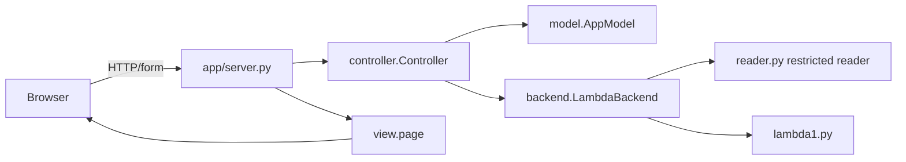

# Architecture

| Component | Implementation | Responsibility |
|---|---|---|
| Model | `AppModel` | Applied source, revision, result, busy state, artifact invalidation; no HTTP/HTML. |
| View | `view.page` | Escaped editor/status/control rendering and browser file-to-editor copy; no analysis/evaluation. |
| Controller | `Controller` | Applies source, dispatches operations, enforces bounded request wait, records result. |
| Adapter | `LambdaBackend`, `reader.py` | Constructor validation and calls to `lambda1`; replaceable tool boundary. |

## Load → Lint → Interpret trace

1. The browser reads an uploaded text file into the editor; Apply reaches `Controller.change_source`.
2. The model accepts nonempty text, increases revision, and invalidates its artifact/result.
3. Lint dispatches to the backend, which safely parses the constructors and calls `d0exp_fvset` without evaluating. An empty set produces success; otherwise deterministic names produce an invalid-input/language-error result.
4. Interpret independently parses and calls `d0exp_evaluate` with `ENVnil`. Runtime errors and `D0V000` sentinels are errors, not values.
5. The model records only a result for its current revision and the view displays escaped text.

## Result contract

Every `Result(operation, revision, kind, text, artifact)` has kinds `success`, `invalid-input-or-language-error`, `backend-failure`, or `not-implemented`. Timeout is a backend failure. Type-check/Compile are explicitly not implemented. Execute is unavailable while `artifact` is absent.

## Decisions and tradeoffs

The restricted AST reader avoids arbitrary Python execution; the tradeoff is that input is limited to documented constructor calls. The controller coordinates the adapter rather than the model, keeping state rules testable and backend substitution simple; it adds a small orchestration layer.

A future type checker/compiler replaces the corresponding adapter methods. A successful compiler returns a generated-code artifact tagged with the source revision. The model stores it only for that revision and invalidates it on edits or failed compilation. Execute receives that artifact directly and never silently recompiles.
